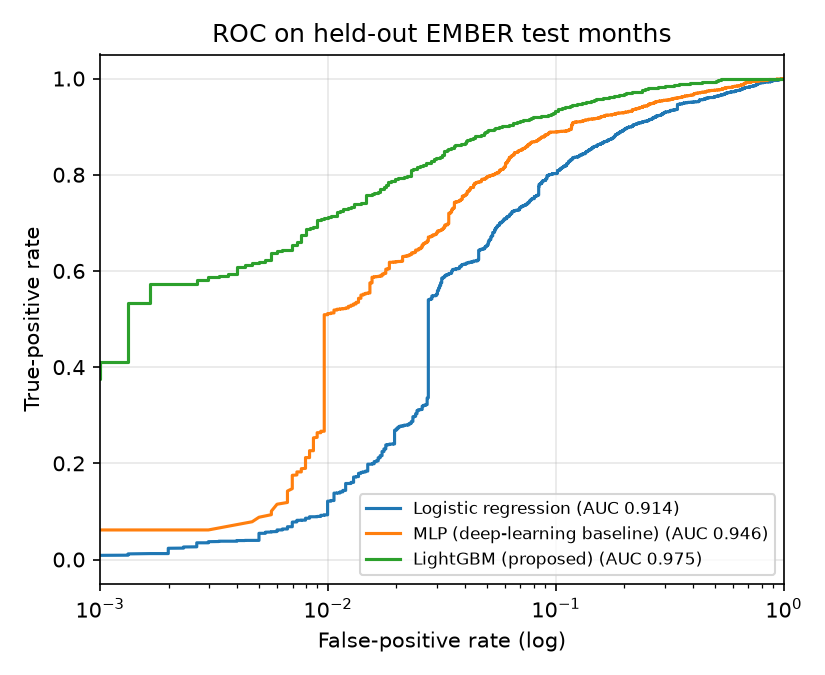
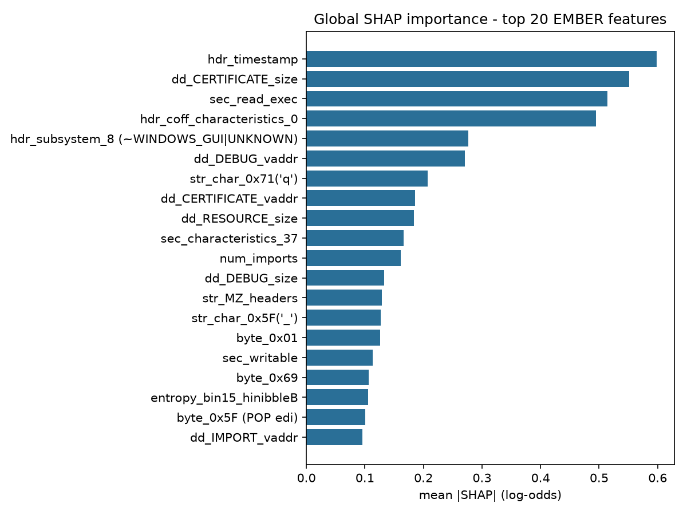
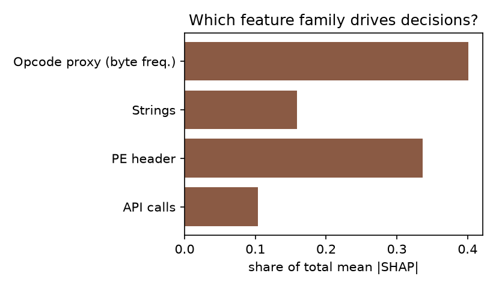
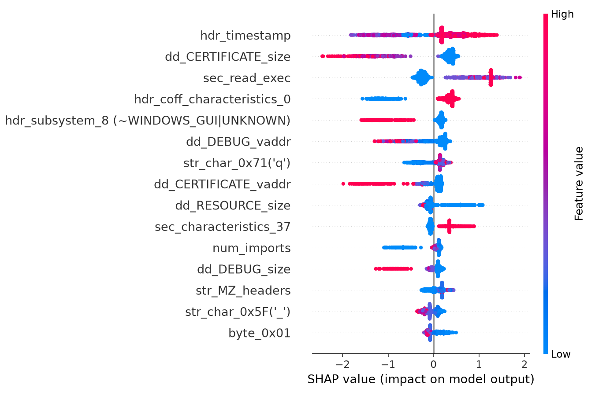
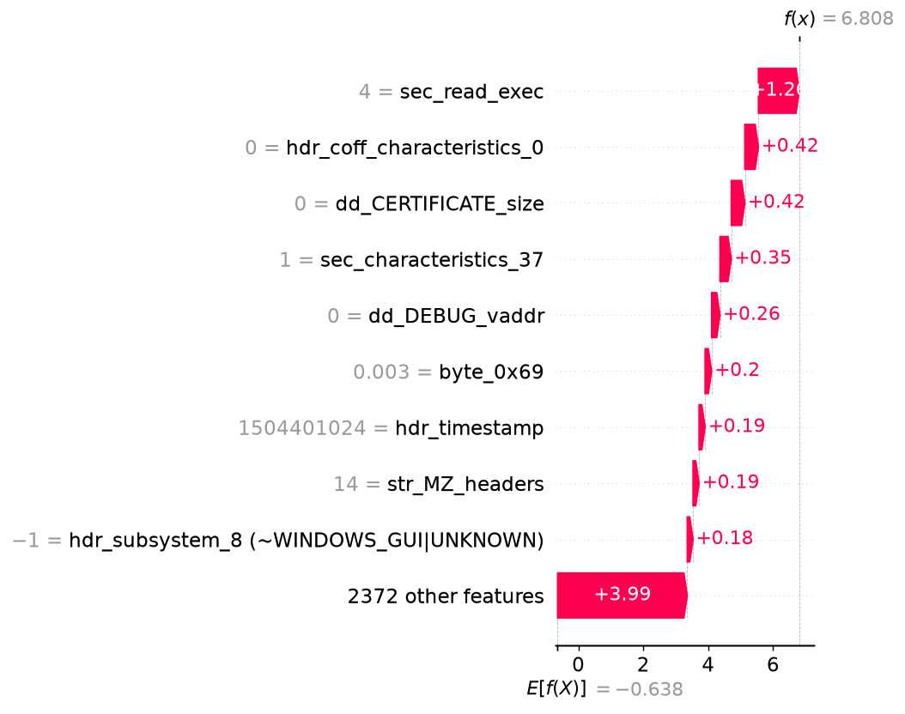

# Explainable AI-Based Malware Classification System

Project report - Watermarking course · Team member: Vedant Agarwal · Code: github.com/karanjain10/malware-xai

## Abstract

Deep-learning malware detectors reach high accuracy but give an analyst no reason for a verdict, which makes them hard to trust, audit or debug. This project builds a static Windows PE malware classifier on the public EMBER-2018 dataset using four feature families (PE header, byte-frequency as an opcode proxy, API-call imports and string statistics) and explains each decision with SHAP and LIME. A LightGBM model reaches an AUC of 0.975 and detects 71.1 % of malware at a 1 % false-positive rate on 6 000 held-out files, ahead of a logistic-regression baseline (AUC 0.914) and an MLP deep-learning baseline (AUC 0.946). We then measure the explanations instead of only showing them: SHAP is deterministic and passes a deletion (faithfulness) test, while LIME on all 2 381 sparse features fails (surrogate R² of 0.05) and only becomes usable when restricted to the 60 most important features. The system turns the explanations into a plain-English malware report per file.

## 1. Problem statement

Deep-learning and gradient-boosted malware detectors act as black boxes. A SOC analyst who receives "malware, 99 %" cannot tell which properties of the file triggered the alert, cannot judge whether the model has latched onto a spurious shortcut, and cannot defend a decision to a user whose legitimate program was blocked. Regulators and security teams increasingly require explanations for automated decisions.

**Goal.** Build a malware classifier on PE header features, opcode frequencies and API calls, explain every prediction with SHAP and LIME, and produce a human-readable malware report.

## 2. Objectives

1. Classify PE files as benign or malicious from static features of the EMBER dataset.
2. Compare an interpretable baseline, a neural-network (deep-learning) baseline and a gradient-boosted model.
3. Explain predictions globally and per file with SHAP and LIME.
4. Quantify explanation quality: agreement, stability and faithfulness.
5. Generate a per-file report an analyst can read without knowing the feature encoding.

## 3. Literature review

**Static ML malware detection.** Kolter and Maloof (2006) showed that byte n-grams and boosted decision trees can detect unseen executables. Saxe and Berlin (2015) fed byte-entropy histograms, import hashes and header metadata to a deep network, the feature design EMBER later standardised. Raff et al. (2018) proposed MalConv, which learns directly from raw bytes with a convolutional network, removing feature engineering at the price of opacity.

**EMBER.** Anderson and Roth (2018) released one million PE files (800 k training files, of which 200 k are unlabelled, and 200 k test files) with raw features and a 2 381-dimensional vector: byte histogram, byte-entropy histogram, string statistics, general file info, header, section, hashed import and export, and data-directory features. Their LightGBM baseline is the reference point for later work, and the TPR at a fixed low false-positive rate is the headline metric.

**Explanation methods.** LIME (Ribeiro et al., 2016) fits a sparse linear surrogate on perturbations around one instance and works with any model. SHAP (Lundberg and Lee, 2017) assigns Shapley-value feature contributions with consistency guarantees; TreeSHAP (Lundberg et al., 2020) computes them exactly and quickly for tree ensembles. LightGBM (Ke et al., 2017) is the efficient tree learner we use.

**Explanations in security.** Warnecke et al. (2020) evaluate explanation methods on security tasks, including malware, and find that methods differ widely in fidelity and robustness. Alvarez-Melis and Jaakkola (2018) show that explanations can be unstable under small input changes, and Slack et al. (2020) show that LIME and SHAP can be fooled by adversarial models. Pendlebury et al. (2019) show that malware classifiers degrade over time and that evaluations must respect temporal ordering. Severi et al. (2021) use SHAP to choose the trigger features of backdoor poisoning attacks on EMBER classifiers.

**Gap addressed.** Most work either reports detection accuracy or shows example explanations. We combine the two and quantify explanation quality (agreement, stability, deletion test), and we convert explanations into analyst-readable reports.

## 4. Methodology

### 4.1 Data

EMBER-2018 feature vectors, obtained from the public HuggingFace mirror `cw1521/ember2018`. Each row is one PE file: 2 381 features, a label (benign/malware/unlabelled), SHA-256, first-seen month and an AV-derived family name. Because the full dataset is large, we used a sample of 11 shards: 8 train shards (12 241 labelled files after dropping unlabelled rows, 45.2 % malware) and 3 test shards (6 000 files, 49.9 % malware). Shards are not shuffled, so the training shards were spread evenly across the dataset.

### 4.2 Features and the three requested families

The EMBER vector has nine blocks. We name every column and map the blocks to the families requested in the problem statement:

| Family | EMBER blocks | Columns | What it captures |
|---|---|---|---|
| PE header | general, header, section, data directories | 357 | size, compile timestamp, subsystem, section count / entropy / permissions, signature, debug, resources |
| Opcode proxy | byte histogram, byte-entropy histogram | 512 | frequency of each byte value and windowed entropy; labelled with the x86 single-byte opcode (e.g. 0xE8 = CALL) |
| API calls | imports, exports | 1 408 | hashed import table (256 library + 1 024 function bins) and export table |
| Strings | string statistics | 104 | counts of paths, URLs, registry keys, "MZ" headers, printable-character distribution |

Two deviations from a literal reading of the brief, both forced by the dataset:

* **Opcodes.** EMBER does not contain disassembly, so true opcode n-gram frequencies are not available. The byte histogram is the closest available proxy: in compiled x86 code the bytes 0x55, 0x8B, 0xE8, 0xFF and so on are the opcodes of PUSH, MOV, CALL and group-5 instructions. We label the bins accordingly, but a byte count also includes data and immediates.
* **API calls.** Imports are feature-hashed, so a column index does not say which function it is. We re-hash about 200 well-known Windows API names and library names with the same hash function and use the inverse mapping as a *hint* (`imp_api_1 (~kernel32.dll:CreateRemoteThread)`). Several APIs can collide in the same bin, and we did not validate the decoding against raw import tables, so the names are indicative only.

### 4.3 Models

| Model | Role | Configuration |
|---|---|---|
| Logistic regression | interpretable baseline | signed log1p transform, standardisation, C = 0.05 |
| MLP | deep-learning black-box baseline | 2381-256-128-1, early stopping, same preprocessing |
| LightGBM | proposed model | 500 trees, learning rate 0.05, 31 leaves, 30 % column sampling |

A feature-family ablation trains LightGBM on each family alone and on all families but one.

### 4.4 Explainability

* **SHAP.** TreeSHAP on the LightGBM model: exact per-file contributions in log-odds, aggregated into global importance (mean |SHAP|), per-family shares and a beeswarm plot, computed on 1 500 random test files.
* **LIME.** Tabular LIME with quartile discretisation, 2 000 perturbation samples, 20 features. Because LIME is model-agnostic we also apply it to the MLP. For LightGBM we run it two ways: on all 2 381 columns, and restricted to a subset of the K columns with the highest LightGBM gain (all other columns frozen at the file's own values).

### 4.5 Evaluating the explanations

On 40 randomly chosen, correctly detected malware files:

* **Agreement**: Jaccard overlap of the top-10 features of SHAP and LIME, and whether shared features have the same sign.
* **Stability**: top-10 overlap between two LIME runs with different random seeds. SHAP is deterministic.
* **Surrogate fit**: R² of LIME's local linear model.
* **Faithfulness (deletion test)**: replace the top-k features named by an explainer by the benign median and measure the mean fall in the malware probability. A good explainer should cause a larger fall than random features.

### 4.6 Report generator

`src/report.py` takes a test file and writes a Markdown report: verdict, probability, risk level (LOW / MEDIUM / HIGH / CRITICAL), the ten strongest SHAP reasons translated into plain English (API behaviour notes, byte/opcode frequencies, decoded compile date), the share of the decision per feature family, a LIME cross-check and a SHAP waterfall figure.

## 5. Implementation

Python 3.11, scikit-learn, LightGBM, SHAP, LIME and matplotlib. The code lives in `src/` (`download.py`, `data.py`, `features.py`, `train.py`, `explain.py`, `report.py`); `run_all.sh` reproduces everything in about ten minutes, and `tests/test_features.py` checks the column layout. Trained models, metrics, figures and sample reports are committed to the repository.

## 6. Results

### 6.1 Detection performance

6 000 held-out test files.

| Model | AUC | Accuracy | F1 | TPR @ 1 % FPR | TPR @ 0.1 % FPR |
|---|---|---|---|---|---|
| Logistic regression | 0.914 | 85.6 % | 0.855 | 12.1 % | 0.9 % |
| MLP (deep-learning baseline) | 0.946 | 89.7 % | 0.895 | 51.1 % | 2.1 % |
| LightGBM (proposed) | 0.975 | 91.7 % | 0.917 | 71.1 % | 41.1 % |

LightGBM confusion matrix: 2 748 true negatives, 260 false positives, 236 false negatives, 2 756 true positives.

### 6.2 Which feature family matters?

| Features used | AUC | TPR @ 1 % FPR |
|---|---|---|
| All families | 0.975 | 71.1 % |
| Only PE header | 0.965 | 63.1 % |
| Only opcode proxy (bytes) | 0.939 | 53.5 % |
| Only strings | 0.931 | 53.3 % |
| Only API calls | 0.877 | 47.7 % |
| Without PE header | 0.961 | 63.1 % |
| Without opcode proxy | 0.973 | 71.1 % |
| Without strings | 0.974 | 69.7 % |
| Without API calls | 0.975 | 71.9 % |

PE header features are the strongest single family and the only one whose removal clearly hurts (AUC 0.975 to 0.961). The other families carry overlapping information: dropping any one of them barely changes the result. Hashed API features alone are the weakest, which is expected because 1 280 hashed bins dilute individual APIs.

### 6.3 Global explanations (SHAP)

The most important features are the compile timestamp, the size of the certificate data directory (that is, whether the file is Authenticode-signed), the number of readable-and-executable sections, a COFF characteristics bin, and the subsystem. By family, the share of total mean |SHAP| is opcode proxy 40.1 %, PE header 33.6 %, strings 15.9 % and API calls 10.4 %. The opcode proxy holds many weak features (512 columns) whose combined weight is large, whereas the PE header holds a few very strong ones.

### 6.4 Quality of the explanations

| Check (40 detected malware files) | Result |
|---|---|
| LIME on all 2 381 columns: top-10 overlap with SHAP / surrogate R² | 0.00 / 0.05 |
| LIME on top-30 columns | 0.37 / 0.56 |
| LIME on top-60 columns (used) | 0.35 / 0.47 |
| LIME on top-100 columns | 0.33 / 0.47 |
| Sign agreement of shared SHAP and LIME features (top-60) | 84.8 % |
| LIME stability across seeds, top-10 overlap (top-60) | 0.68 |
| SHAP stability across runs | 1.00 (deterministic) |
| LIME on the MLP vs LIME on LightGBM, top-10 overlap | 0.38 |

The sensitivity rows, the seed-stability row and the MLP row use the first 15 of the 40 files; the other rows use all 40. Deletion test, mean fall in malware probability:

| Features neutralised | k = 5 | k = 10 | k = 20 |
|---|---|---|---|
| SHAP top-k (per file) | 0.117 | 0.182 | 0.335 |
| LIME top-60, top-k positive (per file) | 0.069 | 0.119 | 0.069 |
| Global importance top-k (same for all files) | 0.026 | 0.025 | 0.062 |
| Random features | 0.000 | 0.000 | 0.000 |

Findings:

1. **SHAP is the more faithful explainer.** Neutralising the 20 features SHAP names lowers the malware probability by 0.34 on average, five times more than the global ranking and far more than random features.
2. **Vanilla LIME fails on this data.** With 2 381 mostly sparse features its local surrogate explains almost none of the model's behaviour (R² 0.05) and its top-10 shares nothing with SHAP. Restricting LIME to the 60 globally most important columns raises R² to 0.47.
3. **Even then LIME is only partly consistent.** Overlap with SHAP is 0.35 and two seeds agree on about two thirds of the top-10, but when the two methods name the same feature they agree on its direction 85 % of the time. The LIME deletion score is not monotonic in k because its top-20 list contains few positive features.
4. **The explanation method is model-agnostic**, so the MLP black box can be opened with LIME. Its explanations overlap those of LightGBM by only 0.38, which shows that the two models use partly different evidence even though both detect most malware.

### 6.5 Example malware report

`reports/518a3da0ec92.md` (a correctly detected file of the xtrat family, 99.9 % malware) lists as top reasons: four readable-and-executable sections (+1.26 log-odds), no Authenticode certificate (+0.42), no debug directory (+0.26) and a compile timestamp of 2017-09-03 (+0.19), grouped by family and cross-checked with LIME. A benign file is explained the same way and receives a LOW risk level (4.2 %). Reports for three malware files and one benign file are in `reports/`.

## 7. Discussion and limitations

* **Shortcut features.** The compile timestamp is the top feature. It carries real signal in EMBER (forged or zeroed stamps and temporally clustered malware families) but is also a dataset artefact; for example, a benign test file with a June 1992 stamp, a value typical of some Delphi toolchains, is pushed towards benign. A deployed model would need protection against an attacker who simply changes the stamp. Likewise "no signature" reflects how EMBER's benign files were collected.
* **Sample size.** 18 241 files, about 2 % of EMBER-2018, one random seed, no confidence intervals. The ranking of the models is large enough to be credible, but small differences (for example in the ablation) are not significant. Shards are not shuffled, so the sample is not perfectly random.
* **Opcode and API features are approximations** as described in section 4.2.
* **Explanations are not causal.** They describe what the model uses, not what the malware does. Slack et al. (2020) show that LIME and SHAP can be fooled by an adversary, and we did not test adversarial robustness.
* **Evaluation.** Pendlebury et al. (2019) show that accuracy on randomly mixed data overstates real-world accuracy under concept drift; we use the official split but did not analyse time decay.
* **No raw binaries.** Scoring a new executable needs EMBER's LIEF-based extractor, which is not included.

## 8. Connection to watermarking

The course topic is watermarking, which this project does not implement. The link is the security of the model itself: backdoor-based watermarking embeds a secret trigger pattern into a model so that its owner can later prove ownership (Adi et al., 2018; Uchida et al., 2017), and the same mechanism is used as an attack. Severi et al. (2021) show that SHAP-ranked features are the best place to hide a backdoor trigger in an EMBER classifier. The explanation pipeline built here therefore (a) identifies which features a watermark or backdoor trigger could use without hurting accuracy, and (b) could be used to audit a model for unexpected high-influence features that indicate an embedded trigger. Implementing and testing such a watermark is a natural extension.

## 9. Conclusion and future work

A LightGBM classifier on EMBER features detects 71 % of malware at 1 % false positives (AUC 0.975), clearly better than a logistic-regression and an MLP baseline, and each decision can be explained in plain English. SHAP proved the more faithful, deterministic and efficient explainer; LIME needed feature restriction to work at all and remained unstable. Future work: use the full dataset and a temporal split, validate the import-hash decoding against raw binaries, add real opcode n-grams from disassembly, test explanation robustness against adversarial manipulation, and implement a backdoor watermark and its SHAP-based audit.

## References

1. H. S. Anderson and P. Roth. EMBER: An Open Dataset for Training Static PE Malware Machine Learning Models. arXiv:1804.04637, 2018.
2. E. Raff, J. Barker, J. Sylvester, R. Brandon, B. Catanzaro and C. Nicholas. Malware Detection by Eating a Whole EXE. AAAI Workshop on AI for Cyber Security, 2018.
3. J. Saxe and K. Berlin. Deep Neural Network Based Malware Detection Using Two Dimensional Binary Program Features. MALWARE, 2015.
4. J. Z. Kolter and M. A. Maloof. Learning to Detect and Classify Malicious Executables in the Wild. Journal of Machine Learning Research 7, 2006.
5. S. M. Lundberg and S.-I. Lee. A Unified Approach to Interpreting Model Predictions. NeurIPS, 2017.
6. S. M. Lundberg et al. From Local Explanations to Global Understanding with Explainable AI for Trees. Nature Machine Intelligence 2, 2020.
7. M. T. Ribeiro, S. Singh and C. Guestrin. "Why Should I Trust You?": Explaining the Predictions of Any Classifier. KDD, 2016.
8. G. Ke et al. LightGBM: A Highly Efficient Gradient Boosting Decision Tree. NeurIPS, 2017.
9. A. Warnecke, D. Arp, C. Wressnegger and K. Rieck. Evaluating Explanation Methods for Deep Learning in Security. IEEE European Symposium on Security and Privacy, 2020.
10. D. Slack, S. Hilgard, E. Jia, S. Singh and H. Lakkaraju. Fooling LIME and SHAP: Adversarial Attacks on Post Hoc Explanation Methods. AAAI/ACM AIES, 2020.
11. G. Severi, J. Meyer, S. Coull and A. Oprea. Explanation-Guided Backdoor Poisoning Attacks Against Malware Classifiers. USENIX Security, 2021.
12. Y. Adi, C. Baum, M. Cisse, B. Pinkas and J. Keshet. Turning Your Weakness Into a Strength: Watermarking Deep Neural Networks by Backdooring. USENIX Security, 2018.
13. Y. Uchida, Y. Nagai, S. Sakazawa and S. Satoh. Embedding Watermarks into Deep Neural Networks. ACM ICMR, 2017.
14. F. Pendlebury, F. Pierazzi, R. Jordaney, J. Kinder and L. Cavallaro. TESSERACT: Eliminating Experimental Bias in Malware Classification across Space and Time. USENIX Security, 2019.
15. D. Alvarez-Melis and T. Jaakkola. On the Robustness of Interpretability Methods. ICML Workshop on Human Interpretability, 2018.
