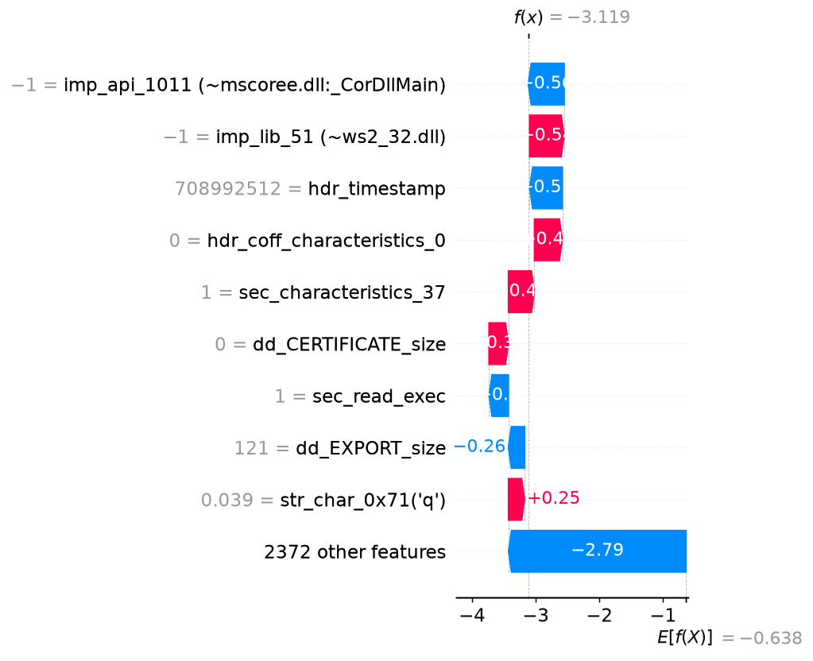

# Malware analysis report - `228a4fa6d31c902a…`

| | |
|---|---|
| **Verdict** | BENIGN |
| **Malware probability** | 4.2% |
| **Risk level** | LOW |
| **First seen** | 2018-11 |
| **Ground-truth label** | benign |

## Why the model decided this (SHAP)

Positive = pushes towards *malware*, negative = towards *benign* (log-odds units).

1. **-0.56** - the file imports a function hashing like `mscoree.dll:_CorDllMain` (hash-bin value -1)  _[API calls]_
2. **+0.54** - the file links against a library hashing like `ws2_32.dll` (hash-bin value -1)  _[API calls]_
3. **-0.51** - the file claims a compile timestamp of 1992-06-19 (forged or zeroed stamps are common in malware)  _[PE header]_
4. **+0.44** - the file has `hdr_coff_characteristics_0` = 0  _[PE header]_
5. **+0.41** - the file has `sec_characteristics_37` = 1  _[PE header]_
6. **+0.31** - the file has `dd_CERTIFICATE_size` = 0  _[PE header]_
7. **-0.30** - the file has `sec_read_exec` = 1  _[PE header]_
8. **-0.26** - the file has `dd_EXPORT_size` = 121  _[PE header]_
9. **+0.25** - the file has `str_char_0x71('q')` = 0.03924  _[Strings]_
10. **-0.22** - the file has `imp_api_458` = 1  _[API calls]_

## Evidence by feature family

| Family | Share of the decision |
|---|---|
| Opcode proxy (byte freq.) | 35% |
| PE header | 28% |
| API calls | 24% |
| Strings | 13% |

## Cross-check with LIME

LIME (a different, model-agnostic method, run on the 60 most important features) picks 5 of the same top-10 features as SHAP (Jaccard overlap 0.33). LIME's strongest malware-pushing features:

- dd_CERTIFICATE_size (weight +0.022)
- dd_CERTIFICATE_vaddr (weight +0.021)
- dd_DEBUG_vaddr (weight +0.013)
- dd_DEBUG_size (weight +0.008)
- has_debug (weight +0.006)

_Caveat: the hash-decoded names (`~…`) are hints - different APIs can collide in the same hash bin._
