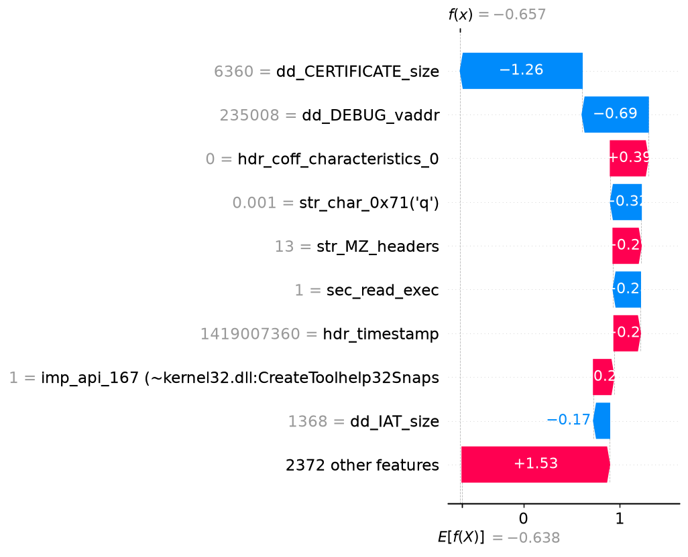

# Malware analysis report - `25a6d2ccb0b843d3…`

| | |
|---|---|
| **Verdict** | BENIGN |
| **Malware probability** | 34.1% |
| **Risk level** | LOW |
| **First seen** | 2018-11 |
| **Ground-truth label** | benign |

## Why the model decided this (SHAP)

Positive = pushes towards *malware*, negative = towards *benign* (log-odds units).

1. **-1.26** - the file has `dd_CERTIFICATE_size` = 6360  _[PE header]_
2. **-0.69** - the file has `dd_DEBUG_vaddr` = 2.35e+05  _[PE header]_
3. **+0.39** - the file has `hdr_coff_characteristics_0` = 0  _[PE header]_
4. **-0.32** - the file has `str_char_0x71('q')` = 0.000903  _[Strings]_
5. **+0.29** - the file has `str_MZ_headers` = 13  _[Strings]_
6. **-0.28** - the file has `sec_read_exec` = 1  _[PE header]_
7. **+0.27** - the file claims a compile timestamp of 2014-12-19 (forged or zeroed stamps are common in malware)  _[PE header]_
8. **+0.21** - the file imports a function hashing like `kernel32.dll:CreateToolhelp32Snapshot` - enumerates processes (hash-bin value +1)  _[API calls]_
9. **-0.17** - the file has `dd_IAT_size` = 1368  _[PE header]_
10. **+0.15** - the file has `hdr_subsystem_8 (~WINDOWS_GUI|UNKNOWN)` = -1  _[PE header]_

## Evidence by feature family

| Family | Share of the decision |
|---|---|
| Opcode proxy (byte freq.) | 37% |
| PE header | 31% |
| API calls | 18% |
| Strings | 14% |

## Cross-check with LIME

LIME (a different, model-agnostic method, run on the 60 most important features) picks 5 of the same top-10 features as SHAP (Jaccard overlap 0.33). LIME's strongest malware-pushing features:

- str_MZ_headers (weight +0.061)
- dd_EXPORT_size (weight +0.047)
- str_urls(http://) (weight +0.027)
- byte_0x7B (weight +0.022)
- str_char_0x5F('_') (weight +0.021)

_Caveat: the hash-decoded names (`~…`) are hints - different APIs can collide in the same hash bin._
