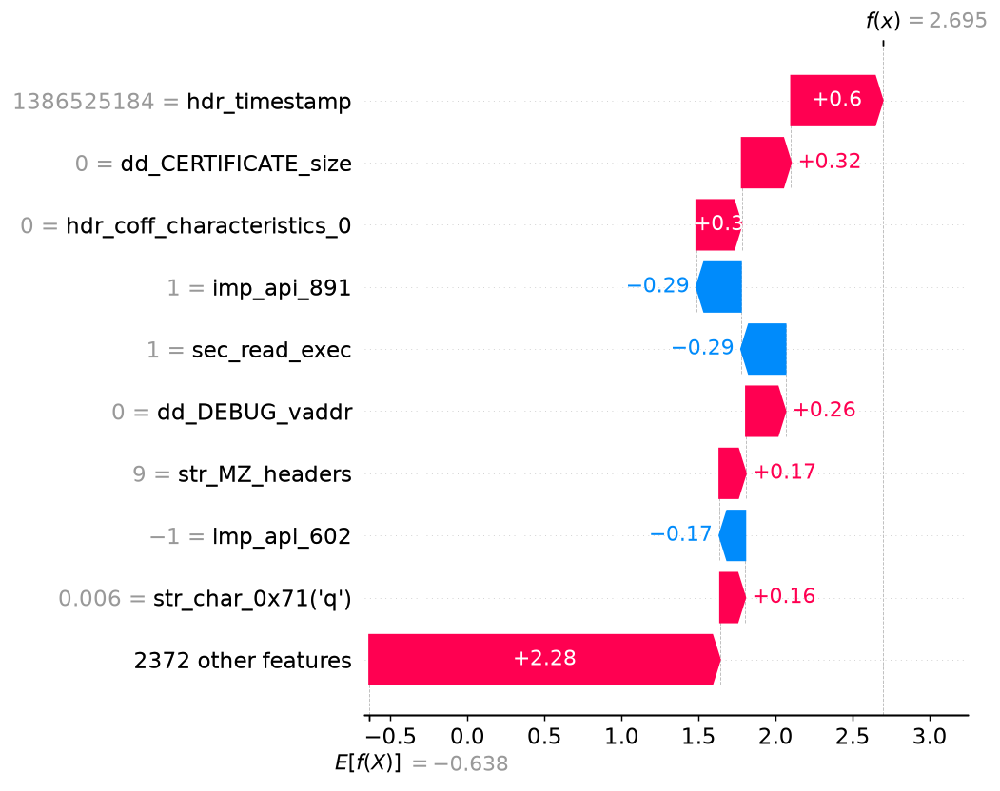

# Malware analysis report - `27d3e3c4936cb4ea…`

| | |
|---|---|
| **Verdict** | MALWARE |
| **Malware probability** | 93.7% |
| **Risk level** | HIGH |
| **First seen** | 2018-11 |
| **Ground-truth label** | malware (AV family: zbot) |

## Why the model decided this (SHAP)

Positive = pushes towards *malware*, negative = towards *benign* (log-odds units).

1. **+0.60** - the file claims a compile timestamp of 2013-12-08 (forged or zeroed stamps are common in malware)  _[PE header]_
2. **+0.32** - the file has `dd_CERTIFICATE_size` = 0  _[PE header]_
3. **+0.30** - the file has `hdr_coff_characteristics_0` = 0  _[PE header]_
4. **-0.29** - the file has `imp_api_891` = 1  _[API calls]_
5. **-0.29** - the file has `sec_read_exec` = 1  _[PE header]_
6. **+0.26** - the file has `dd_DEBUG_vaddr` = 0  _[PE header]_
7. **+0.17** - the file has `str_MZ_headers` = 9  _[Strings]_
8. **-0.17** - the file has `imp_api_602` = -1  _[API calls]_
9. **+0.16** - the file has `str_char_0x71('q')` = 0.005957  _[Strings]_
10. **+0.16** - the file has `hdr_subsystem_8 (~WINDOWS_GUI|UNKNOWN)` = -1  _[PE header]_

## Evidence by feature family

| Family | Share of the decision |
|---|---|
| Opcode proxy (byte freq.) | 41% |
| PE header | 25% |
| API calls | 20% |
| Strings | 14% |

## Cross-check with LIME

LIME (a different, model-agnostic method, run on the 60 most important features) picks 5 of the same top-10 features as SHAP (Jaccard overlap 0.33). LIME's strongest malware-pushing features:

- dd_CERTIFICATE_vaddr (weight +0.172)
- dd_DEBUG_vaddr (weight +0.141)
- dd_CERTIFICATE_size (weight +0.105)
- entropy_bin15_hinibbleE (weight +0.073)
- byte_0x20 (weight +0.061)

_Caveat: the hash-decoded names (`~…`) are hints - different APIs can collide in the same hash bin._
