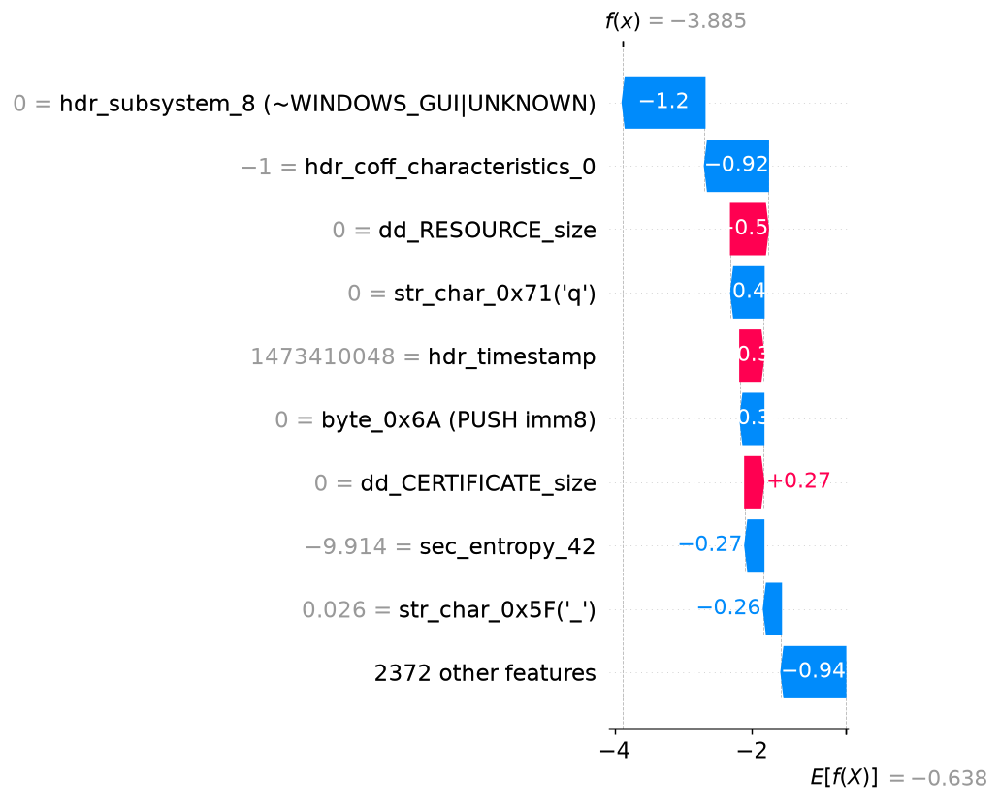

# Malware analysis report - `a1b22119e9d3bb90…`

| | |
|---|---|
| **Verdict** | BENIGN |
| **Malware probability** | 2.0% |
| **Risk level** | LOW |
| **First seen** | 2018-11 |
| **Ground-truth label** | benign |

## Why the model decided this (SHAP)

Positive = pushes towards *malware*, negative = towards *benign* (log-odds units).

1. **-1.20** - the file has `hdr_subsystem_8 (~WINDOWS_GUI|UNKNOWN)` = 0  _[PE header]_
2. **-0.92** - the file has `hdr_coff_characteristics_0` = -1  _[PE header]_
3. **+0.54** - the file has `dd_RESOURCE_size` = 0  _[PE header]_
4. **-0.48** - the file has `str_char_0x71('q')` = 0.0001352  _[Strings]_
5. **+0.34** - the file claims a compile timestamp of 2016-09-09 (forged or zeroed stamps are common in malware)  _[PE header]_
6. **-0.34** - the file contains byte `0x6A (PUSH imm8)` at 0.03% of its bytes (opcode-frequency proxy)  _[Opcode proxy (byte freq.)]_
7. **+0.27** - the file has `dd_CERTIFICATE_size` = 0  _[PE header]_
8. **-0.27** - the file has `sec_entropy_42` = -9.914  _[PE header]_
9. **-0.26** - the file has `str_char_0x5F('_')` = 0.02595  _[Strings]_
10. **+0.22** - the file has `dd_DEBUG_vaddr` = 0  _[PE header]_

## Evidence by feature family

| Family | Share of the decision |
|---|---|
| Opcode proxy (byte freq.) | 42% |
| PE header | 35% |
| Strings | 15% |
| API calls | 8% |

## Cross-check with LIME

LIME (a different, model-agnostic method, run on the 60 most important features) picks 4 of the same top-10 features as SHAP (Jaccard overlap 0.25). LIME's strongest malware-pushing features:

- dd_CERTIFICATE_vaddr (weight +0.051)
- hdr_subsystem_8 (~WINDOWS_GUI|UNKNOWN) (weight +0.044)
- dd_CERTIFICATE_size (weight +0.038)
- dd_DEBUG_vaddr (weight +0.029)
- byte_0x69 (weight +0.027)

_Caveat: the hash-decoded names (`~…`) are hints - different APIs can collide in the same hash bin._
