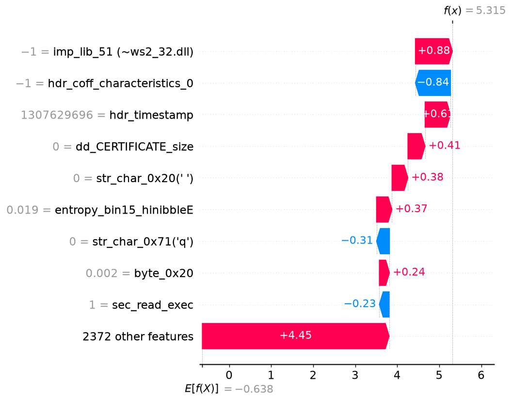

# Malware analysis report - `cfef50a14e84ad79…`

| | |
|---|---|
| **Verdict** | MALWARE |
| **Malware probability** | 99.5% |
| **Risk level** | CRITICAL |
| **First seen** | 2018-11 |
| **Ground-truth label** | malware (AV family: yunsip) |

## Why the model decided this (SHAP)

Positive = pushes towards *malware*, negative = towards *benign* (log-odds units).

1. **+0.88** - the file links against a library hashing like `ws2_32.dll` (hash-bin value -1)  _[API calls]_
2. **-0.84** - the file has `hdr_coff_characteristics_0` = -1  _[PE header]_
3. **+0.61** - the file claims a compile timestamp of 2011-06-09 (forged or zeroed stamps are common in malware)  _[PE header]_
4. **+0.41** - the file has `dd_CERTIFICATE_size` = 0  _[PE header]_
5. **+0.38** - the file has `str_char_0x20(' ')` = 0.0004901  _[Strings]_
6. **+0.37** - the file has 1.87% of its windows in entropy bucket 15 / high-nibble E (packed or encrypted data is high-entropy)  _[Opcode proxy (byte freq.)]_
7. **-0.31** - the file has `str_char_0x71('q')` = 2.41e-05  _[Strings]_
8. **+0.24** - the file contains byte `0x20` at 0.19% of its bytes (opcode-frequency proxy)  _[Opcode proxy (byte freq.)]_
9. **-0.23** - the file has `sec_read_exec` = 1  _[PE header]_
10. **+0.22** - the file has `dd_DEBUG_vaddr` = 0  _[PE header]_

## Evidence by feature family

| Family | Share of the decision |
|---|---|
| Opcode proxy (byte freq.) | 37% |
| PE header | 25% |
| Strings | 22% |
| API calls | 16% |

## Cross-check with LIME

LIME (a different, model-agnostic method, run on the 60 most important features) picks 4 of the same top-10 features as SHAP (Jaccard overlap 0.25). LIME's strongest malware-pushing features:

- dd_CERTIFICATE_size (weight +0.313)
- dd_CERTIFICATE_vaddr (weight +0.244)
- dd_DEBUG_vaddr (weight +0.143)
- has_debug (weight +0.062)
- hdr_coff_characteristics_0 (weight +0.062)

_Caveat: the hash-decoded names (`~…`) are hints - different APIs can collide in the same hash bin._
