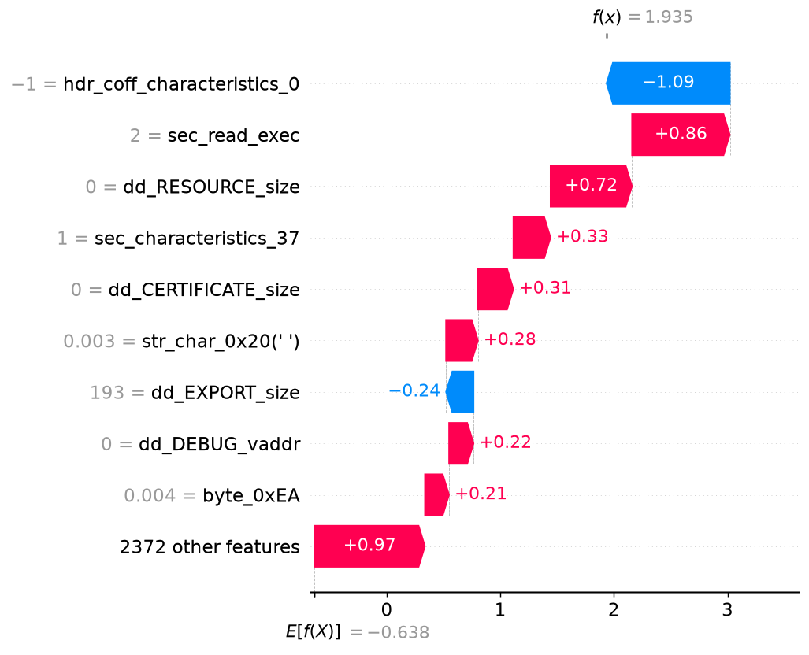

# Malware analysis report - `ffeca0e985a4e922…`

| | |
|---|---|
| **Verdict** | MALWARE |
| **Malware probability** | 87.4% |
| **Risk level** | HIGH |
| **First seen** | 2018-12 |
| **Ground-truth label** | malware (AV family: delf) |

## Why the model decided this (SHAP)

Positive = pushes towards *malware*, negative = towards *benign* (log-odds units).

1. **-1.09** - the file has `hdr_coff_characteristics_0` = -1  _[PE header]_
2. **+0.86** - the file has `sec_read_exec` = 2  _[PE header]_
3. **+0.72** - the file has `dd_RESOURCE_size` = 0  _[PE header]_
4. **+0.33** - the file has `sec_characteristics_37` = 1  _[PE header]_
5. **+0.31** - the file has `dd_CERTIFICATE_size` = 0  _[PE header]_
6. **+0.28** - the file has `str_char_0x20(' ')` = 0.003101  _[Strings]_
7. **-0.24** - the file has `dd_EXPORT_size` = 193  _[PE header]_
8. **+0.22** - the file has `dd_DEBUG_vaddr` = 0  _[PE header]_
9. **+0.21** - the file contains byte `0xEA` at 0.42% of its bytes (opcode-frequency proxy)  _[Opcode proxy (byte freq.)]_
10. **+0.20** - the file contains byte `0x5A` at 0.43% of its bytes (opcode-frequency proxy)  _[Opcode proxy (byte freq.)]_

## Evidence by feature family

| Family | Share of the decision |
|---|---|
| Opcode proxy (byte freq.) | 41% |
| PE header | 37% |
| Strings | 15% |
| API calls | 8% |

## Cross-check with LIME

LIME (a different, model-agnostic method, run on the 60 most important features) picks 5 of the same top-10 features as SHAP (Jaccard overlap 0.33). LIME's strongest malware-pushing features:

- dd_CERTIFICATE_size (weight +0.254)
- dd_DEBUG_vaddr (weight +0.182)
- dd_CERTIFICATE_vaddr (weight +0.182)
- hdr_coff_characteristics_0 (weight +0.180)
- sec_read_exec (weight +0.113)

_Caveat: the hash-decoded names (`~…`) are hints - different APIs can collide in the same hash bin._
